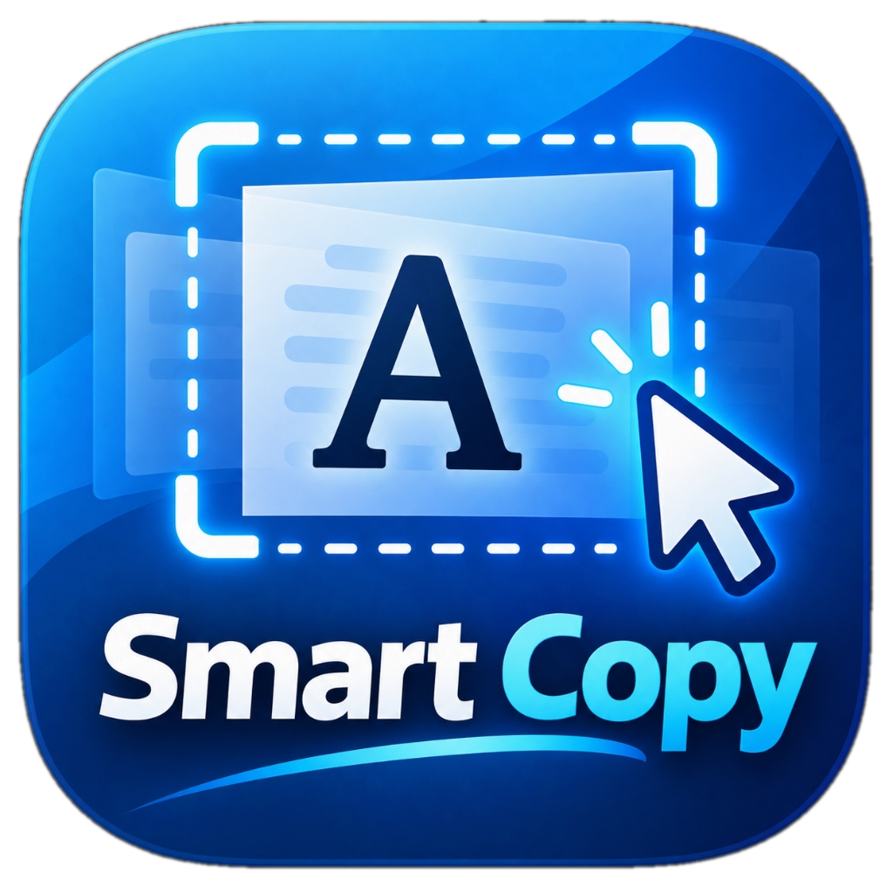

# Smart Copy — Universal Windows OCR Selection Utility

  

Smart Copy is a high-performance, privacy-first Windows desktop utility that lets you copy non-selectable text from virtually anywhere on your screen using an intuitive global mouse-and-keyboard gesture and a lightweight two-point selection overlay.

---

## Directory Structure

This repository is organized into two primary folders:

- **[\Portable-Exe/\](./Portable-Exe)**: Contains the standalone, pre-built portable executable (\SmartCopy.exe\). Zero installation or runtime dependencies required—simply download and run.
- **[\Project-Files/\](./Project-Files)**: Complete C# / .NET 8 source code, unit tests, build scripts, Inno Setup installer scripts, and documentation.

---

## Quick Start (Portable Edition)

1. Navigate to the **[\Portable-Exe/\](./Portable-Exe)** folder and download **\SmartCopy.exe\**.
2. Run \SmartCopy.exe\. The app docks into your Windows system tray.
3. Hold **Left Ctrl + Left Alt** and **Right-Click** anywhere.
4. Click the start and end of any screen text to copy it directly to your clipboard.

For full developer instructions and building from source, see **[\Project-Files/README.md\](./Project-Files/README.md)**.
